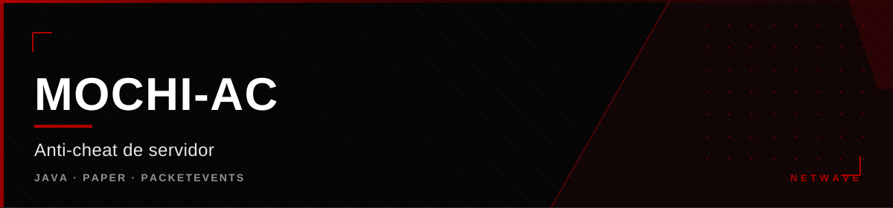

<div align="center">



</div>

<div align="center">

[](https://github.com/hiro0010/mochi-ac) [](https://github.com/hiro0010/mochi-ac) [](https://github.com/hiro0010/mochi-ac) [](https://github.com/hiro0010/mochi-ac)

</div>


## O que é

Anti-cheat de servidor para Minecraft, em Java, sobre Paper/Bukkit.
Sua função é detectar advantageadores e anomalias de movimento, combate e
comportamento de cliente — do lado do servidor, que é a única autoridade
confiável num jogo onde o cliente não diz a verdade sobre si mesmo.

---

## Como funciona

O Mochi-AC não confia em checks de integridade do lado do cliente: um
cliente comprometido mente sobre si próprio. A estratégia é **simulação** —
o servidor reconstrói o estado esperado do jogador e compara com o que
chega pelos pacotes.

```
Pacote de movimento → simulação de física (gravidade, atrito, aceleração)
  → comparação com a posição declarada
  → divergência? → check dispara → nível de violação (VL)
  → tier de confiança: NORMAL → CONFIRMED
```

O acúmulo de vantagem é **low-and-slow**: violações pequenas e repetidas
são mais suspeitas que um salto isolado.

---

## Checks

| Categoria | O que observa |
|---|---|
| **Movimento** | Speed, Timer, fly, disparada, elytra |
| **Combate** | KillAura por CPS de pacotes, Reach (posição do pacote vs alvo) |
| **Pacotes** | Duplicação, reordenação, sequências inválidas |
| **Brand** | Identificação de marca do cliente — bloqueia listas conhecidas |

Os checks de combate e brand foram introduzidos na v1.1/v1.2, com detecção de
KillAura por CPS dos pacotes `ATTACK` e de Reach comparando a posição do
pacote com a do alvo.

---

## Stack

| Camada | Tecnologia |
|---|---|
| Linguagem | Java |
| Plataforma | Paper / Bukkit (1.21.x) |
| Dependência | PacketEvents |
| Java | 17+ |

Validado no **Paper 1.21.11** com 15 checks ativos e boot limpo.

---

## Operação

```
/mochi reload    recarrega a configuração
/mochi vl        mostra níveis de violação
/mochi bench     benchmark de impacto no tick
/mochi logs      histórico de detecções
```

Configuração em `config.yml`, com thresholds por check.

---

## Decisão de design: alert-only

Em produção o Mochi roda em **alert-only** — registra e reporta, mas **não
expulsa**. A punição automática fica desligada até existir um pipeline de
punição com validação (canário → comparar → punir) e um banco de violações
central.

A ausência de punição é intencional: kicking errado destrói confiança, e
falsos positivos em anti-cheat são o problema clássico do domínio.

---

## Desempenho

Medido no laboratório com 50 jogadores e 1000 pacotes/s: **+2.4 ms de MSPT**
(~16% do tick), com TPS 20 estável até 100 bots. Caminho quente na casa das
centenas de nanossegundos por pacote.

Validação de falsos positivos: 0 em mineração com EffV/Haste, em cenários de
exemptions, com RTT de 0–200 ms e sob carga.

---

## Diferencial

Os concorrentes (Grim, Vulcan, Matrix, Spartan) foram desenhados para redes
**premium online-mode**. O Mochi-AC é próprio e roda em rede **mista**
(pirata + premium no mesmo IP e porta), com Velocity + Paper 1.21.11 em PT-BR,
e cobre brand/mods do ambiente Netwave. Custo zero, código próprio, tuning no
tráfego real.


<div align="center">

<sub>Parte da <a href="https://github.com/hiro0010/netwave">Netwave</a>
&middot; Owner: <a href="https://github.com/hiro0010">Hiro</a></sub>

</div>
